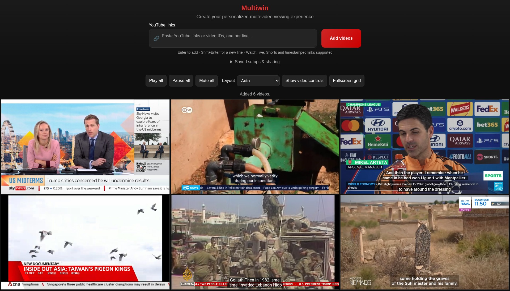

# YouTube Multiscreen Player

A simple, responsive web application that allows users to watch multiple YouTube videos simultaneously in a grid layout.

**[Launch Multiwin →](https://ymode.github.io/multiwin/)** — open the app, paste a
YouTube link, and start watching. No download or installation required.



Live news wall featuring [Sky News](https://www.youtube.com/@SkyNews),
[DW News](https://www.youtube.com/@dwnews),
[FRANCE 24 English](https://www.youtube.com/@france24_en),
[CNA](https://www.youtube.com/@channelnewsasia),
[Al Jazeera English](https://www.youtube.com/@aljazeeraenglish), and
[Euronews](https://www.youtube.com/@euronews).


## Features

- Add multiple YouTube videos to a single page
- Responsive grid layout that adapts to screen size
- Support for various YouTube URL formats
- Individual video removal controls
- Clean, modern user interface
- Keyboard support (Enter to add videos)
- Auto-play enabled for added videos

## Usage

1. Launch the application using the [installation instructions](#installation) below
2. Paste one or more YouTube URLs into the input field (separate them with spaces or new lines)
3. Click "Add videos" or press Enter to add them to the grid; Shift+Enter inserts a new line
4. Repeat to add more videos
5. Click the '×' button on any video to remove it from the grid

## Arrange the grid

Choose **Auto**, **2 columns**, or **Focus one video**. Auto balances rows to
avoid isolated streams; six videos form a 3 × 2 wall when space allows. The ◎ button focuses a
card, placing it first with a larger viewing area and the other videos beside
it. On phones, every layout becomes one column. Size preferences are remembered
and clamped to the available space. **Fullscreen grid** keeps layout and shared
playback controls available while hiding the page header.

Drag a card’s ⠿ handle to the left or right half of another card to insert it before or
after that card; a green edge shows the destination. Focus mode keeps its main
video first, so switch to Auto or 2 columns to reorder. Browsers supporting
`Element.moveBefore` retain the embedded player while moving it; older browsers
may reload the moved embed. Layout and focused video are saved with setups.
Open **Saved setups & sharing** for preset and sharing controls.

## Touch, keyboard and accessibility

Videos sit in a compact grid with 4px gaps and thin, square edges. Card controls
appear over the top of a video on mouse hover or keyboard focus, leaving the
picture and news tickers unobstructed while watching. **Show video controls**
keeps them visible for touchscreens or arranging several streams; **Hide video
controls** clears them again. Controls never add space around a video.

Buttons retain 44px touch targets, descriptive labels and visible focus rings.
Tab reaches every available control. **Move earlier** and **Move later** provide
a keyboard and touch alternative to dragging; they announce the new position.
Removal moves keyboard focus to a neighboring card or the input when the grid becomes empty.
Use **Skip to video controls** to bypass the header.

Reduced-motion preferences disable animations and transitions. Continuous title
and empty-state animations have been removed. The YouTube iframe has a title,
and input validation and playback messages are announced to assistive technology.

## Playback controls

Use **Listen to this** in a video’s controls to hear it while muting the others. The
selected card is highlighted; click **Listening · mute** or **Mute all** to
silence it. **Pause all** and **Play all** control the whole grid. New players
respect Pause all even if they finish loading later.

Audio selection is remembered with a setup, but restored and shared grids start
muted. Choose **Resume audio** to enable sound. YouTube or the browser can block
autoplay; use the individual player's Play button when prompted. Unavailable,
private and non-embeddable videos show a recovery message with a YouTube link.
If the shared control API cannot load, the native embedded controls remain usable.

## Saved setups and sharing

The grid is saved automatically in this browser, including video order and sizes.
Refreshing restores it. Use **Save preset** to keep a named setup, then select it
and choose **Load** to replace the current grid. Saving an existing name updates
that preset; **Delete preset** removes the saved copy without changing the grid.
Up to 100 videos per setup and 50 named presets are supported.

**Copy setup link** shares the video list, order, sizes and start offsets in the
URL fragment. No account or Multiwin backend is involved. Anyone with the link
can read and open that setup. Opening a shared link replaces the current grid;
later edits are saved locally and do not change the shared snapshot. A local
`127.0.0.1` link works only on a computer running its own copy; use the hosted app
for links you send to other people. Presets and sessions belong to the current
browser and site address. Clearing browser data removes them. If storage or
clipboard access is blocked, watching still works and a selectable share link is
shown when needed.

## Supported URL Formats

The player accepts video IDs and these URL formats (including mobile YouTube links):

- Watch: `https://www.youtube.com/watch?v=VIDEO_ID`
- Short: `https://youtu.be/VIDEO_ID`
- Embed: `https://www.youtube.com/embed/VIDEO_ID`
- Live: `https://www.youtube.com/live/VIDEO_ID`
- Shorts: `https://www.youtube.com/shorts/VIDEO_ID`

Start times such as `?t=90`, `&t=1m30s`, `?start=90` and `#t=90` are preserved
when adding, restoring and sharing videos. Supported start offsets are zero to
seven days. Only recognized YouTube hosts and exact 11-character IDs are accepted.
Playlist-only links need to be replaced with individual video links.

For a mixed batch, valid links are added while rejected links stay in the input
with an explanation. You can correct and resubmit them without adding the valid
ones again. Repeated video links are allowed for comparing different moments.

## Technical Details

- Pure HTML, CSS, and JavaScript implementation
- No build step or third-party application dependencies
- Responsive design using CSS Grid
- YouTube iframe embeds with the IFrame Player API for shared controls

## Browser Support

Works in all modern browsers that support:
- CSS Grid
- ES6 JavaScript
- YouTube iframe embeds

## Installation

For normal use, [open the hosted app](https://ymode.github.io/multiwin/). The
instructions below are for running your own copy.

Serve the application over HTTP or HTTPS. **Do not double-click `index.html` or
open it with a `file://` URL.** YouTube requires a browser-provided HTTP `Referer`
or equivalent client identification; local-file launches cannot provide a normal
HTTP origin and can cause **Error 153**.

### Local launch (Python 3)

Download or clone this repository, then open a terminal in its folder:

```sh
python3 serve.py
```

On Windows, use `py serve.py` instead. Python 3.7 or newer is required for this
optional launcher; it uses only the standard library, with nothing to install
from pip. It opens `http://127.0.0.1:8000/` in your default browser. If a browser
does not open, copy the printed address into one. Keep the terminal running while
using Multiwin; press Ctrl+C to stop it.

If port 8000 is already in use, run `python3 serve.py --port 0` to select a free
port (or `--port 8001` to choose one). Add `--no-browser` to print the address
without opening a browser. The launcher works from any working directory, binds
only to this computer's loopback interface, and serves only `index.html`.

If you downloaded only `index.html`, Python's built-in static server also works.
Run this from the folder containing that file, then visit `http://127.0.0.1:8000/`:

```sh
python3 -m http.server 8000 --bind 127.0.0.1
```

This alternative serves the entire current directory, so use a dedicated folder.

### Static hosting (no Python required)

This repository deploys to GitHub Pages after changes to the app are merged into
`main`. The **Publish Multiwin** workflow uploads only `index.html`; source,
tests, and local tools are not included in the website. To set this up in a fork,
choose **Settings → Pages → Build and deployment → Source: GitHub Actions**,
then run **Publish Multiwin** from the Actions tab on `main`. Update the launch
links in this README to the Pages URL for your fork. Feature branches and pull
requests do not deploy to the public site.

Upload `index.html` to any static HTTPS host and open its hosted URL. No backend,
API key, package installation or build is needed. For GitHub Pages, publish the
repository's root directory using your repository's Pages settings, then use the
URL GitHub provides. Do not use a GitHub `blob` or `raw` URL as the player page.
The Python launcher is for local use, not public hosting.

### Error 153 troubleshooting

- Check that the address starts with `http://` or `https://`. A local-file launch
  now shows instructions and disables video creation until opened via a server.
- The page and its video iframes explicitly use
  `strict-origin-when-cross-origin`, YouTube's recommended referrer policy. This
  lets the browser send the hosting origin without exposing the page's path or
  query string. It does not fabricate a `Referer` or fix a `file://` origin.
- If the error persists on HTTP/HTTPS, inspect the request to
  `https://www.youtube.com/embed/...` in your browser's Network tools. Its request
  headers should include `Referer: <your hosting origin>/`. Check whether browser
  privacy settings, extensions, a proxy, or hosting configuration removes it.
- If autoplay is blocked, click the player's Play button. Private, removed,
  age/region-restricted or non-embeddable videos may still fail independently.

See YouTube's [Error 153 definition](https://developers.google.com/youtube/iframe_api_reference#Events)
and [client identification requirements](https://developers.google.com/youtube/terms/required-minimum-functionality#api-client-identity-and-credentials).

## Checks

Test the local launcher using the Python standard library:

```sh
python3 -m unittest discover -s tests -p 'test_*.py' -v
```

For browser regression checks, install the **development-only** Playwright and axe-core tools
(Node.js 18+), then run:

```sh
npm ci
npx playwright install chromium
npm test
```

Set `PYTHON` to your Python 3 executable if it is not `python3` (for example,
`$env:PYTHON = "py"` in PowerShell). The browser checks intercept YouTube requests
to verify the real browser-generated referrer and UI behaviour without depending
on YouTube availability. **They do not prove actual YouTube playback.**

Set `LIVE_YOUTUBE=1` to also attempt live playback of the issue's video and
YouTube's API example video. This opt-in diagnostic requires media time to
advance, and reports blocked playback as **skipped, not verified** with details.
CI enables this diagnostic; a green workflow alone does not mean live playback
passed. Read the diagnostic results in the job log.

For a live playback check, launch Multiwin, add a known embeddable video and
confirm the video actually advances, then test adding a second video, resizing,
reordering, fullscreen and removal. Check the embed request's `Referer` in Network
tools. Record the browser, launch URL and any YouTube error; loading an iframe
alone is not a successful playback test.

Keyboard, touch, focus recovery, and automated WCAG A/AA accessibility checks
run against intercepted players as part of the deterministic suite. Automated
checks cover the app interface; they do not certify third-party YouTube content.

## License

Feel free to use and modify this code for your own projects.
